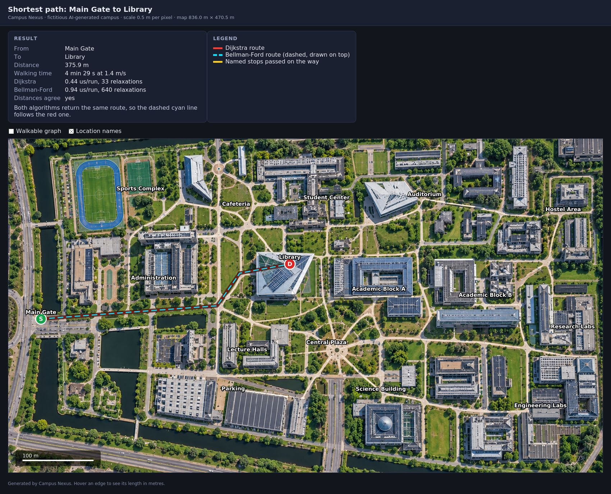

# Campus Nexus: Intelligent Pathfinding & Navigation

A graph-based campus navigation system written in **C++17** for the *Data Structures and Algorithms (C++)* PBL course.
The campus is modelled as a weighted graph (locations and path junctions = vertices, walkable paths = edges, weight = metres).

This repository implements everything that [RudraxDave/CampusNavigation](https://github.com/RudraxDave/CampusNavigation)
(a "TrojanMap" style C++ map application) delivers up to **Phase 2**, re-built for **Windows 11** with
**no external libraries**: no OpenCV, no ncurses. Results are drawn as an interactive HTML/SVG overlay on the campus image and open in any browser.



## What is implemented (Phase 1 + Phase 2)

| Phase | Feature | Where | Complexity |
|---|---|---|---|
| 1 | Node / graph data structure, map loaded from CSV | `CampusMap::Load` | O(V + E) |
| 1 | **Autocomplete** (case-insensitive prefix search) | `CampusMap::Autocomplete` | O(n·m) + sort |
| 1 | **Get position** of a location | `CampusMap::GetPosition` | O(1) (hash lookup) |
| 1 | **Edit distance** and "did you mean ...?" | `CalculateEditDistance`, `FindClosestName` | O(a·b) per name |
| 2 | **Dijkstra** shortest path (binary heap) | `CalculateShortestPathDijkstra` | O((V + E) log V) |
| 2 | **Bellman-Ford** shortest path | `CalculateShortestPathBellmanFord` | O(V·E) |
| 2 | Both paths plotted, **time of each algorithm measured** | menu 3 / `--path` | |
| 2 | **Cycle detection** inside a rectangular area (DFS), cycle drawn on the map | `CampusMap::CycleDetection` | O(V + E) |
| 2 | **Topological sort** (DFS) of locations + dependencies from CSV, order drawn on the map | `CampusMap::DeliveringCampus` | O(V + E) |

Not included on purpose (these are Phase 3 in the reference project): Travelling Salesman variants, Find Nearby, the ncurses UI.

## The campus data

* `images/campus_base.png` is a **fictitious, AI-generated** top-down campus (no copyright issues). It is the map every view is drawn on.
* `images/campus_reference.png` is the same campus with the location names that were used to build the graph.
  (The red "shortest route" in that picture is only illustrative; this program computes its own routes.)
* `data/map.csv`: 47 nodes, **16 named locations** (names exactly as in the reference image) and 31 unnamed junctions/path bends, with pixel coordinates.
* `data/edges.csv`: 64 walkable paths. The weight of each path is **computed**, not typed in: straight-line pixel distance × scale.
* **Real scale:** `data/config.txt` sets `metres_per_pixel=0.5`. The image is generated, so the scale is an assumption:
  1672 × 941 px → **836 m × 470.5 m** (~39 ha), a realistic university campus. Change that one number and every distance, walking time and area input rescales.
  Walking time uses 1.4 m/s (`walking_speed_mps`).

Coordinates for cycle detection are in **metres from the top-left corner** of the map (x to the east, y to the south).

## Build and run on Windows 11

You need one C++17 compiler: **Visual Studio 2022** (workload *Desktop development with C++*) or **MinGW-w64 g++ 9+** (MSYS2 / WinLibs).

```bat
build.bat        :: compiles bin\campus_nexus.exe and bin\campus_tests.exe, then runs the tests
run.bat          :: starts the interactive menu
```

`build.bat` links the C++ runtime into the `.exe` (`-static`), so the program also starts when double-clicked and needs no `libstdc++-6.dll`.

(For MSVC run `build.bat` from the *x64 Native Tools Command Prompt for VS 2022*.)
Alternatives: open the folder in Visual Studio / VS Code (CMake is supported: `CMakeLists.txt`), or compile by hand:

```bat
if not exist bin mkdir bin
g++ -std=c++17 -O2 -static -Iinclude src\campus_map.cpp src\visualizer.cpp src\main.cpp -o bin\campus_nexus.exe
```

On Linux/macOS the same sources compile with `g++ -std=c++17 ...` (the browser is simply not opened automatically; open the files in `output/` yourself).

## Using it

Interactive menu (`run.bat`):

```
 1. Autocomplete a location name
 2. Find the position of a location
 3. Shortest path (Dijkstra vs Bellman-Ford)
 4. Cycle detection in an area
 5. Topological sort (visiting order)
 6. Edit distance between two names
 7. Show the campus graph
 8. Open maps in browser automatically: ON  (toggle)
 0. Exit
```

Misspelled a name? `Libary` -> *"Did you mean 'Library'?"* (edit distance). Typing a unique prefix such as `eng` also works.

Every result is also saved as an HTML map view in `output/` and opened in your browser. Toggle the walkable graph and the location names with the checkboxes; hover an edge to see its length.

Command line (handy for demos and testing):

```bat
bin\campus_nexus.exe --autocomplete ac
bin\campus_nexus.exe --position Library
bin\campus_nexus.exe --path "Main Gate" "Engineering Labs"
bin\campus_nexus.exe --cycle 0 836 0 470.5           :: whole campus  -> cycle found
bin\campus_nexus.exe --cycle 0 220 150 300           :: Main Gate corner -> no cycle
bin\campus_nexus.exe --topo                           :: data\locations.csv + data\dependencies.csv
bin\campus_nexus.exe --topo locations.csv dependencies_cyclic.csv   :: reports the cycle, no valid order
bin\campus_nexus.exe --edit kitten sitting
bin\campus_nexus.exe --graph
bin\campus_nexus.exe --help                           :: add --no-open to skip the browser
```

Sample run:

```
Shortest path: Main Gate -> Library
  Dijkstra     375.9 m, walk about 4 min 29 s, 5 nodes, 0.52 us per run, 33 edge relaxations
  Bellman-Ford 375.9 m, walk about 4 min 29 s, 5 nodes, 0.97 us per run, 640 edge relaxations
  Both algorithms found the same shortest distance.
  Route: Main Gate > Junction #16 > Junction #17 > Junction #18 > Library
```

**About the timings.** Each algorithm is run 2000 times and averaged (one run is below clock resolution). On a graph this small (47 nodes) both take roughly 1-2 µs and the faster one varies per query, because constant factors dominate; the work counters (edge relaxations) and the asymptotic bounds are what separate them on large maps (the reference project reports Bellman-Ford about 80-100x slower than Dijkstra on its much larger USC map).

### Topological sort input

`data/locations.csv` (one location per line) and `data/dependencies.csv` (`Source,Destination`: Source must come before Destination).
Names are case-insensitive. If the dependencies contain a cycle, the cycle is printed and no order is produced.

## Tests

`bin\campus_tests.exe` (built by `build.bat`) runs ~1600 self-checking assertions with no test framework:
data loading and real-scale weights, autocomplete, positions, edit distance, Dijkstra == Bellman-Ford for **every pair** of locations
(plus path validity and symmetry), cycle detection (cycle validity, tree areas, swapped bounds), and topological sort (order respects every dependency, cyclic input rejected, bad names rejected).

## Project layout

```
CampusNexus/
|-- build.bat, run.bat, CMakeLists.txt
|-- data/        config.txt, map.csv, edges.csv, locations.csv, dependencies.csv, dependencies_cyclic.csv
|-- images/      campus_base.png, campus_reference.png
|-- include/campus/   campus_map.h, visualizer.h
|-- src/         campus_map.cpp (algorithms), visualizer.cpp (HTML/SVG views), main.cpp (menu + CLI)
|-- tests/       test_campus.cpp
|-- output/      generated map views (*.html, git-ignored)
`-- docs/screenshots/
```

## Credits

Feature set and project idea: [RudraxDave/CampusNavigation](https://github.com/RudraxDave/CampusNavigation) (C++ map application, Phases 1-2).
Algorithms: Cormen, Leiserson, Rivest, Stein, *Introduction to Algorithms*. Map image: fictitious, AI-generated.
