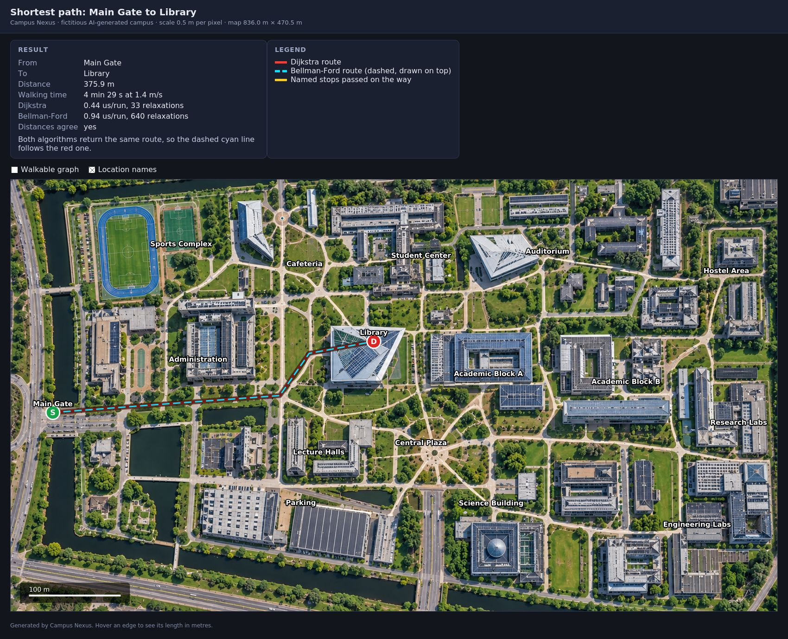
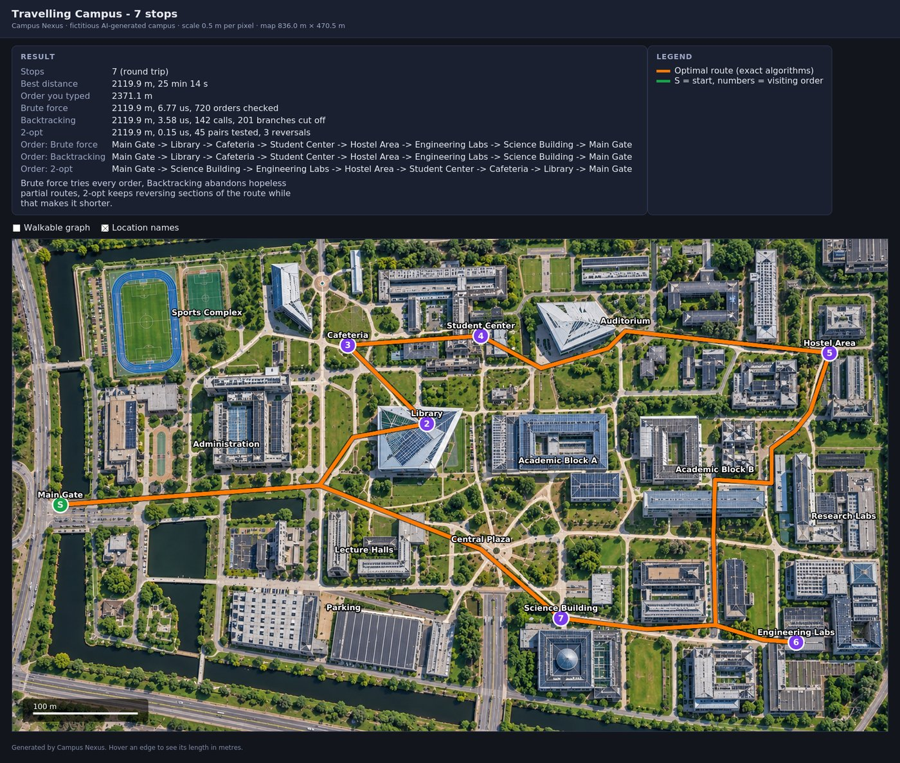

# Campus Nexus: Intelligent Pathfinding & Navigation

A graph-based campus navigation system written in **C++17** for the *Data Structures and Algorithms (C++)* PBL course.
The campus is modelled as a weighted graph (locations and path junctions = vertices, walkable paths = edges, weight = metres).

This repository implements everything that [RudraxDave/CampusNavigation](https://github.com/RudraxDave/CampusNavigation)
(a "TrojanMap" style C++ map application) delivers up to **Phase 2**, re-built for **Windows 11** with
**no external libraries**: no OpenCV, no ncurses. Results are drawn as an interactive HTML/SVG overlay on the campus image and open in any browser.



## What is implemented (Phase 1 + Phase 2)

| Phase | Feature | Where | Complexity |
|---|---|---|---|
| 1 | Node / graph data structure, map loaded from CSV | `CampusMap::Load` | O(V + E) |
| 1 | **Autocomplete** (case-insensitive prefix search) | `CampusMap::Autocomplete` | O(n·m) + sort |
| 1 | **Get position** of a location | `CampusMap::GetPosition` | O(1) (hash lookup) |
| 1 | **Edit distance** and "did you mean ...?" | `CalculateEditDistance`, `FindClosestName` | O(a·b) per name |
| 2 | **Dijkstra** shortest path (binary heap) | `CalculateShortestPathDijkstra` | O((V + E) log V) |
| 2 | **Bellman-Ford** shortest path | `CalculateShortestPathBellmanFord` | O(V·E) |
| 2 | **A\*** shortest path (Dijkstra guided by straight-line distance) | `CalculateShortestPathAStar` | O((V + E) log V) worst case, usually explores far fewer nodes |
| 2 | All three paths plotted, **time and work of each algorithm measured** | menu 3 / `--path` | |
| 2 | **Cycle detection** inside a rectangular area (DFS), cycle drawn on the map | `CampusMap::CycleDetection` | O(V + E) |
| 2 | **Topological sort** (DFS) of locations + dependencies from CSV, order drawn on the map | `CampusMap::DeliveringCampus` | O(V + E) |
| 3 | **Travelling Campus** - best order to visit several stops: **brute force**, **backtracking**, **2-opt** | `TourPlanner` (`tsp.h/.cpp`) | O(n!), O(n!) pruned, O(n²) per pass |

Not included on purpose: Find Nearby and the ncurses UI.

## The campus data

* `images/campus_base.png` is a **fictitious, AI-generated** top-down campus (no copyright issues). It is the map every view is drawn on.
* `images/campus_reference.png` is the same campus with the location names that were used to build the graph.
  (The red "shortest route" in that picture is only illustrative; this program computes its own routes.)
* `data/map.csv`: 47 nodes, **16 named locations** (names exactly as in the reference image) and 31 unnamed junctions/path bends, with pixel coordinates.
* `data/edges.csv`: 64 walkable paths. The weight of each path is **computed**, not typed in: straight-line pixel distance × scale.
* **Real scale:** `data/config.txt` sets `metres_per_pixel=0.5`. The image is generated, so the scale is an assumption:
  1672 × 941 px → **836 m × 470.5 m** (~39 ha), a realistic university campus. Change that one number and every distance, walking time and area input rescales.
  Walking time uses 1.4 m/s (`walking_speed_mps`).

Coordinates for cycle detection are in **metres from the top-left corner** of the map (x to the east, y to the south).

## Build and run on Windows 11

You need one C++17 compiler: **Visual Studio 2022** (workload *Desktop development with C++*) or **MinGW-w64 g++ 9+** (MSYS2 / WinLibs).

```bat
build.bat        :: compiles bin\campus_nexus.exe and bin\campus_tests.exe, then runs the tests
run.bat          :: starts the interactive menu
```

`build.bat` links the C++ runtime into the `.exe` (`-static`), so the program also starts when double-clicked and needs no `libstdc++-6.dll`.

(For MSVC run `build.bat` from the *x64 Native Tools Command Prompt for VS 2022*.)
Alternatives: open the folder in Visual Studio / VS Code (CMake is supported: `CMakeLists.txt`), or compile by hand:

```bat
if not exist bin mkdir bin
g++ -std=c++17 -O2 -static -Iinclude src\campus_map.cpp src\visualizer.cpp src\tsp.cpp src\main.cpp -o bin\campus_nexus.exe
```

On Linux/macOS the same sources compile with `g++ -std=c++17 ...` (the browser is simply not opened automatically; open the files in `output/` yourself).

## Using it

Interactive menu (`run.bat`):

```
 1. Autocomplete a location name
 2. Find the position of a location
 3. Shortest path (Dijkstra vs Bellman-Ford vs A*)
 4. Cycle detection in an area
 5. Topological sort (visiting order)
 6. Edit distance between two names
 7. Show the campus graph
 8. Open maps in browser automatically: ON  (toggle)
 9. TRAVELLING CAMPUS - best route through several stops
10. Travelling Campus scaling test (how the algorithms grow)
 0. Exit
```

Misspelled a name? `Libary` -> *"Did you mean 'Library'?"* (edit distance). Typing a unique prefix such as `eng` also works.

Every result is also saved as an HTML map view in `output/` and opened in your browser. Toggle the walkable graph and the location names with the checkboxes; hover an edge to see its length.

Command line (handy for demos and testing):

```bat
bin\campus_nexus.exe --autocomplete ac
bin\campus_nexus.exe --position Library
bin\campus_nexus.exe --path "Main Gate" "Engineering Labs"
bin\campus_nexus.exe --cycle 0 836 0 470.5           :: whole campus  -> cycle found
bin\campus_nexus.exe --cycle 0 220 150 300           :: Main Gate corner -> no cycle
bin\campus_nexus.exe --topo                           :: data\locations.csv + data\dependencies.csv
bin\campus_nexus.exe --topo locations.csv dependencies_cyclic.csv   :: reports the cycle, no valid order
bin\campus_nexus.exe --edit kitten sitting
bin\campus_nexus.exe --tour "Main Gate" Library Cafeteria "Science Building"           :: round trip, 3 algorithms compared
bin\campus_nexus.exe --no-return --tour "Main Gate" Library Cafeteria "Science Building"  :: one way, no return
bin\campus_nexus.exe --tour-scaling                  :: 3..16 stops: how each algorithm grows
bin\campus_nexus.exe --graph
bin\campus_nexus.exe --help                           :: add --no-open to skip the browser
```

Sample run:

```
Shortest path: Main Gate -> Engineering Labs
  Dijkstra     742.4 m, walk about 8 min 50 s, 9 nodes, 1.10 us per run, 108 edge relaxations, 39 nodes expanded
  Bellman-Ford 742.4 m, walk about 8 min 50 s, 9 nodes, 0.74 us per run, 640 edge relaxations
  A*           742.4 m, walk about 8 min 50 s, 9 nodes, 0.44 us per run, 26 edge relaxations, 9 nodes expanded
  All three algorithms found the same shortest distance.
  A* expanded 9 nodes, Dijkstra 39 (A* is guided towards the target by the straight-line distance).
  Route: Main Gate > Junction #16 > Junction #17 > Central Plaza > Science Building > ... > Engineering Labs
```

**About the timings.** Each algorithm is run 2000 times and averaged (one run is below clock resolution). On a graph this small (47 nodes) both take roughly 1-2 µs and the faster one varies per query, because constant factors dominate; the work counters (edge relaxations) and the asymptotic bounds are what separate them on large maps (the reference project reports Bellman-Ford about 80-100x slower than Dijkstra on its much larger USC map).

### A* in simple words

Dijkstra explores outwards from the start in all directions, like a ripple in water, until it reaches the target. **A\*** does the same, but before choosing the next node it adds a *guess* of how far that node still is from the target.
The guess is the **straight-line distance** (`StraightLineDistance`). Nodes that point towards the target get explored first, so far fewer nodes are touched (see "nodes expanded" in the output).

Why the answer is still exact: a straight line is never longer than any real walk, so the guess never overestimates (it is *admissible*), and every path on this map is itself a straight-line length, so the guess is also *consistent*.
The tests check this for every pair of nodes. On this small map all three algorithms take only microseconds, so compare the **work counters** (nodes expanded, edge relaxations); the time gap grows with the size of the map.

## Travelling Campus (flagship feature)

Pick several locations and find an efficient order to visit all of them, optionally returning to the start
(for example *Main Gate -> Library -> Cafeteria -> Science Building -> Main Gate*). This is the classic
**Travelling Salesman Problem (TSP)**.



**How it works**

1. For every pair of chosen locations, Dijkstra (Phase 2) gives the real walking distance along the campus paths. The numbers are stored in a small
   table, the *distance matrix*.
2. Three algorithms search for the best visiting order using that table. The first stop is always the start.
3. For each algorithm the program prints the **route distance**, the **execution time** and the **final visiting order**, then draws the best route on the map.

| Algorithm | Idea | Result | Time complexity |
|---|---|---|---|
| **Brute force** (`BruteForce`) | Generate every permutation of the other stops (recursion + swapping) and keep the shortest. | Always optimal | O(n!) - exactly (n-1)! orders; limited to 11 stops |
| **Backtracking** (`Backtracking`) | Build the route one stop at a time. If the partial route plus an optimistic estimate of the rest is already not shorter than the best complete route, abandon (prune) that branch. Closest stops are tried first. | Always optimal | O(n!) worst case, far less in practice; handles all 16 locations |
| **2-opt** (`TwoOpt`) | Start from the order you typed; reverse a section of the route whenever that shortens it; repeat until nothing improves. | Very good, not guaranteed optimal | O(n²) per pass |

**The pruning rule in one sentence:** *distances never go negative, so a half-built route that is already as long as the best finished route can only get longer - stop exploring it.*
The "optimistic estimate" is the sum, over the stops still to visit, of the shortest leg that arrives at each of them; the real remaining walk can never be shorter than that.

**Sample result** (`--tour "Main Gate" Library Cafeteria "Science Building" "Engineering Labs" Hostel`):

```
  Algorithm         Distance         Time   Work done
  ----------------------------------------------------------------------------
  Brute force       2119.9 m      1.25 us   120 orders checked
  Backtracking      2119.9 m      1.96 us   80 calls, 69 branches cut off
  2-opt             2119.9 m      0.14 us   30 pairs tested, 3 reversals
```

**Scaling test** (`--tour-scaling`, menu 10) shows complexity analysis with real numbers (round trip, times on one laptop-class machine):

| stops n | brute force orders | brute force time | backtracking calls | backtracking time | 2-opt time |
|---|---|---|---|---|---|
| 8 | 5,040 | 49 us | 1,165 | 29 us | 0.15 us |
| 10 | 362,880 | 3.9 ms | 1,264 | 56 us | 0.21 us |
| 11 | 3,628,800 | 41 ms | 2,593 | 145 us | 0.21 us |
| 12 | skipped (39,916,800) | - | 7,107 | 0.53 ms | 0.24 us |
| 16 | skipped (15! = 1.3 x 10^12) | - | 884,548 | 81 ms | 0.49 us |

Brute force grows by a factor of about n with every extra stop (factorial growth). Backtracking explores only a tiny part of the search tree.
2-opt stays almost flat, and on this campus it was within about 2% of the optimum even for 16 stops.
For very few stops (3-6) all three take a few microseconds and the pruning overhead can make backtracking marginally *slower*; the benefit appears from about 8 stops on.

**About the timings.** Each algorithm is repeated until at least ~5 ms have passed and the average is reported, because one tiny run is below the clock resolution.
Exact numbers depend on your computer; the *work counters* (orders checked, recursive calls, pairs tested) do not.

**Where the code is:** `include/campus/tsp.h` (class `TourPlanner`, struct `TourResult`) and `src/tsp.cpp`; menu/CLI in `src/main.cpp`
(`CmdTour`, `CmdTourScaling`); tests in `tests/test_campus.cpp` (`TestTravellingCampus`).
DSA involved: permutations, recursion, backtracking with pruning (branch and bound), optimisation, local search, complexity analysis.

### Topological sort input

`data/locations.csv` (one location per line) and `data/dependencies.csv` (`Source,Destination`: Source must come before Destination).
Names are case-insensitive. If the dependencies contain a cycle, the cycle is printed and no order is produced.

## Tests

`bin\campus_tests.exe` (built by `build.bat`) runs ~5700 self-checking assertions with no test framework:
data loading and real-scale weights, autocomplete, positions, edit distance, Dijkstra == Bellman-Ford == A* for **every pair** of locations (and the A* guess never exceeds the true distance for any pair of nodes)
(plus path validity and symmetry), cycle detection (cycle validity, tree areas, swapped bounds), topological sort (order respects every dependency, cyclic input rejected, bad names rejected), and Travelling Campus
(brute force == backtracking on 120 random stop sets, 2-opt never beats the optimum and never lengthens a route, orders are valid permutations,
reported distance equals the real length of the reported order, the drawn walk follows real campus paths).

## Project layout

```
CampusNexus/
|-- build.bat, run.bat, CMakeLists.txt
|-- data/        config.txt, map.csv, edges.csv, locations.csv, dependencies.csv, dependencies_cyclic.csv
|-- images/      campus_base.png, campus_reference.png
|-- include/campus/   campus_map.h, visualizer.h, tsp.h
|-- src/         campus_map.cpp (algorithms), tsp.cpp (Travelling Campus), visualizer.cpp (HTML/SVG views), main.cpp (menu + CLI)
|-- tests/       test_campus.cpp
|-- output/      generated map views (*.html, git-ignored)
`-- docs/screenshots/
```

## Credits

Feature set and project idea: [RudraxDave/CampusNavigation](https://github.com/RudraxDave/CampusNavigation) (C++ map application, Phases 1-2).
Algorithms: Cormen, Leiserson, Rivest, Stein, *Introduction to Algorithms*. Map image: fictitious, AI-generated.
